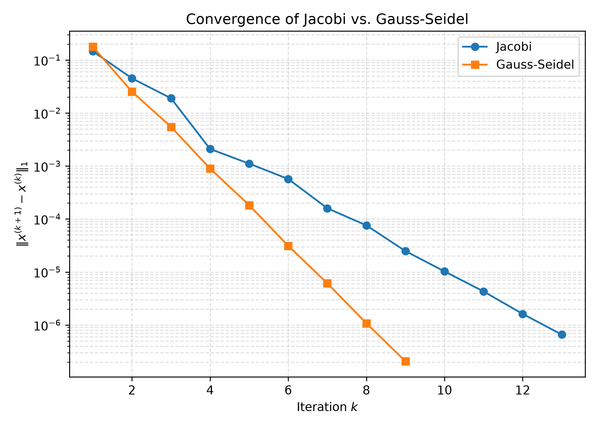

# Iterative Methods for Linear Systems


*From an Exam Problem to Convergence Theory*  
Atharva Kharwadkar · October 20, 2026

[Read the formatted report (PDF)](Iterative_Methods_Report.pdf)

---

## Introduction and Problem Statement

### Introduction

The problems in this report are inspired by a midterm exam from EME115 (Numerical Analysis) - an upper-division applied mathematics elective for mechanical engineering at the University of California, Davis.

During the exam, I solved these problems by hand, iterating only a handful of times using a non-scientific calculator to emulate truncation errors. Upon reflection, I believed that it would be a great opportunity for me to solve these problems computationally. This enables me to explore how and why the results differ, and related problems that could not be tested during the exam.

### Problem Setup

We consider the system $Ax = b$, where $A$ and $b$ are: 

$$
A = \begin{pmatrix}
        5 & 1 & 2 \\
        1 & 3 & -1 \\
        1 & 1 & 2.5
    \end{pmatrix},
    \quad
    b = \begin{pmatrix}
        8 \\
        3 \\
        4.5
    \end{pmatrix}
$$

**Diagonal Dominance:**

A matrix is strictly diagonally dominant if $|A_{ii}| > \sum_{j \neq i} |A_{ij}|$ for all $i$.

- Row 1: $|5| > |1| + |2|$

- Row 2: $|3| > |1| + |-1|$

- Row 3: $|2.5| > |1| + |1|$

Thus, matrix A is diagonally dominant. Strict diagonal dominance is the cheapest condition to prove convergence, although the rate of convergence still needs to be investigated.

## Jacobi Method

The Jacobi method updates each component independently based on the previous iteration: 

$$
x_i^{(k+1)} = \frac{b_i - \sum_{j \neq i} A_{ij} x_j^{(k)}}{A_{ii}}
$$

To confirm the solver is advancing properly, I can compare the first iteration results of the code to what I had solved during the midterm.

[First iteration of Jacobi as solved during Exam](JacobiMapIteration1.pdf)

Matrix A was stored in a 1D array. At 9 elements, there are no benefits in memory usage or process acceleration. However, at scale, this approach could translate to performance gains.

To prevent the solver from iterating infinitely, a tolerance-based stop was implemented. Essentially, the L1 norm is computed between each iteration, decreasing in value gradually. Once that value dips below the tolerance, 1e-6, the solver finishes on that iteration.  

```
x[0], x[1], x[2]
 1: 1.02,     0.966667, 1
 2: 1.00667,  0.993333, 1.00533
 3: 0.9992,   0.999556, 1
 4: 1.00009,  1.00027,  1.0005
 5: 0.999748, 1.00014,  0.999858
 6: 1.00003,  1.00004,  1.00005
 7: 0.999974, 1.00001,  0.999973
 8: 1.00001,  1,        1.00001
 9: 0.999997, 1,        0.999996
10: 1,        1,        1
11: 0.999999, 1,        0.999999
12: 1,        1,        1

x[0] = 1, x[1] = 1, x[2] = 1
Residual norm: 6.50811e-07
Iterations: 13
```

Based on these console logs, we can see the solver did conform to the expected results derived by hand, and continued to converge towards a result in 13 iterations.

## Gauss-Seidel Method

The Gauss-Seidel method immediately uses updated components as soon as they are computed: 

$$
x_i^{(k+1)} = \frac{1}{A_{ii}}\left(b_i - \sum_{j<i} A_{ij}x_j^{(k+1)} - \sum_{j>i} A_{ij}x_j^{(k)}\right)
$$

Like the Jacobi method, the first Gauss-Seidel iteration was also evaluated by hand, and can be used to verify the implementation.

[First iteration of Gauss-Seidel as solved during Exam](GSMapIteration1.pdf)

The handwritten calculation used an initial guess of $x^{(0)}=(1.01,0.99,1.0)^T$, whereas the numerical comparison uses $x^{(0)}=(1.1,0.9,1.0)^T$. Re-running the Gauss-Seidel solver with the midterm exam’s initial guess reproduced the first iteration, $x^{(1)}=(1.002,0.999333,0.999467)^T$.

While Jacobi and Gauss-Seidel are both static iterative methods, their distinction lies in the fact that Gauss-Seidel will substitute newly calculated values for an element as soon as it is available. Essentially, in this 3x3 matrix, the calculation for $x_2^{(1)}$ will use the value found for $x_1^{(1)}$ within that same iteration. Solving for $x_3^{(1)}$ will do the same by using $x_1^{(1)}$ and $x_2^{(1)}$. Jacobi, on the other hand, would use values from $x_i^{(0)}$ for the entire $x_i^{(1)}$ solving iteration.

Another key distinction is that Jacobi typically requires separate arrays to store the iterates at $k$ and $k+1$, since every component update must use values from iteration $k$. Gauss-Seidel, by contrast, can update the solution vector in place, reducing additional memory requirements.

```
x[0], x[1], x[2]
1: 1.02,    0.993333, 0.994667
2: 1.00347, 0.997067, 0.999787
3: 1.00067, 0.999705, 0.999849
4: 1.00012, 0.99991,  0.999988
5: 1.00002, 0.999989, 0.999996
6: 1,       0.999997, 1
7: 1,       1,        1
8: 1,       1,        1

x[0] = 1, x[1] = 1, x[2] = 1
Residual norm: 1.066e-07
Iterations: 9
```

The Gauss-Seidel method converges in 4 fewer iterations than the Jacobi method.

| Method       | Iterations to converge | Final $\|x_{k+1}-x_k\|_1$ |      Residual norm       |
|:-------------|:----------------------:|:-------------------------:|:------------------------:|
| Jacobi       |           13           | $6.58911 \times 10^{-7}$  | $6.50811 \times 10^{-7}$ |
| Gauss-Seidel |           9            | $2.06084 \times 10^{-7}$  | $1.06600 \times 10^{-7}$ |

Jacobi vs. Gauss-Seidel Empirical Comparison

### Why these methods converge

These methods converge due to error contraction. Observe the following: 

$$
x^{(k+1)} = Mx^{(k)} + c
$$

 And the exact solution: 

$$
x^{e} = Mx^{e} + c
$$

 Therefore, the error 

$$
\begin{aligned}
    e^{(k+1)} &= x^{(k+1)} - x^{e} \\
    &= (Mx^{(k)} + c) - (Mx^{e} + c) \\
    &= M(x^{(k)} - x^{e}) \\
    &= Me^{(k)}
\end{aligned}
$$

 This also means that every solver iteration applies $M$ once to the current error. 

$$
\begin{aligned}
    e^{(k+1)} &= Me^{(k)} \\
    e^{(1)} &= Me^{(0)}, \space
    e^{(2)} = Me^{(1)} \\
    &= M(Me^{(0)}) \\
    &= M^{2}e^{(0)} \\
    \therefore e^{(k)} &= M^{k}e^{(0)}
\end{aligned}
$$

Now to briefly describe how Spectral Radius is a marker for convergence, $v_i$ denotes an eigenvector of $M$, satisfying $Mv_i = \lambda_iv_i$, and $c_i$ represents its contribution to the initial error. 

$$
e^{(0)} = \sum_{i}^{}c_iv_i
$$

$$
e^{(k)} = M^{k}e^{(0)} = \sum_{i}^{}c_i\lambda^{k}_iv_i
$$

 Where $\lambda^{k}_i$ terms arise from $M^{k}$. Since the spectral radius is defined as $\rho(M) = \max_i|\lambda_i|$, the condition $\rho(M) < 1$ implies that every eigenvalue has magnitude less than one. Consequently, $\lambda^{k}_i \rightarrow 0$ as $k \rightarrow \infty$, causing the error components to vanish. Thus, $e^{(k)} \rightarrow 0$, meaning that the computed solution converges toward the exact solution $x^{*}$.

## Theoretical Explanation: Spectral Radius

The following section constructs the iteration matrices for Jacobi and Gauss-Seidel and extracts their spectral radii to explain convergence behaviors. Section 3.1 established that convergence depends on $\rho(M) < 1$. This section investigates the spectral radii of $M_J$ and $M_{GS}$ using power iteration, examining its effectiveness and limitations.

### Matrix Splitting and Iteration Matrices

Decomposing $A = D - L - U$ where $D$ is diagonal, $L$ is strictly lower triangular, and $U$ is strictly upper triangular yields: 

$$
M_J = D^{-1}(L+U), \qquad M_{GS} = (D-L)^{-1}U
$$

### Forward Substitution

Because $D-L$ is lower triangular, the system $(D-L)x = \text{rhs}$ is solved via forward substitution: 

$$
x_i = \frac{(\text{rhs})_i - \sum_{k<i} T_{i,k}\,x_k}{T_{i,i}}
$$

### Power Iteration

Power iteration begins with an arbitrary guess vector $v^{(0)}$, chosen here as a vector of ones. At each iteration, the iteration matrix M is applied to the current vector, 

$$
w^{(k)} = M v^{(k)},
$$

 Here, $w^{(k)}$ is an intermediate vector between the current and next iterate $v^{(k)}$ & $v^{(k+1)}$. Its Euclidean norm is computed and used to normalize the vector: 

$$
v^{(k+1)} = \frac{w^{(k)}}{||w^{(k)}||_2}.
$$

 The multiply-normalize process is repeated until the change between consecutive norm estimates falls below a prescribed tolerance. 

$$
v^{{(0)}} = c_1e_1 + c_2e_2 + c_3e_3
$$

 Where each eigenvector satisfies $Me_i = \lambda_ie_i$. One multiplication gives 

$$
Mv^{(0)} = c_1\lambda_1e_1 + c_2\lambda_2e_2 + c_3\lambda_3e_3
$$

 And after $k$ iterations, the vector is 

$$
M^kv^{(0)} = c_1\lambda_1^ke_1 + c_2\lambda_2^ke_2 + c_3\lambda_3^ke_3
$$

 Because $|\lambda_1| > |\lambda_2| \geq |\lambda_3|$, repeated multiplication by $M$ causes the dominant eigenvector component to “precipitate” out of the original mixture: the other components become negligible relative to it.

Although repeated multiplication causes the dominant component to gradually "precipitate", normalization is required to maintain numerical stability. It does not cause the dominant eigenvector to emerge faster; rather, it prevents the vector magnitude from approaching zero or growing without bound – this would cause numerical overflow or underflow.

That all explains why the dominant eigenvector emerges, but the implementation does not explicitly compute $M^kv^{(0)}$. Instead, each iteration stores a normalized vector $v^{(k)}$ and computes 

$$
w^{(k)} = Mv^{(k)}.
$$

 Once the dominant component controls the direction of the vector, $Mv^{(k)} \approx \lambda_1 v^{(k)}$. After the first iteration, $v^{(k)}$ has unit Euclidean norm, so, 

$$
\begin{aligned}
    ||w^{(k)}||_2 = ||Mv^{(k)}||_2 \approx ||\lambda_1v^{(k)}||_2 = |\lambda_1| ||v^{(k)}||_2 = 
    |\lambda_1|.
\end{aligned}
$$

 Thus, the norm of the intermediate vector $w^{(k)}$, measured before normalization, estimates the magnitude of the dominant eigenvalue: 

$$
||w^{(k)}||_2 \rightarrow |\lambda_1| = \rho(M).
$$

Process flow of the power iteration is summarized as follows:

```math
v^{(k)}
\xrightarrow{\;M\;}
w^{(k)}
\quad
\begin{cases}
\|w^{(k)}\|_2 & \text{spectral-radius estimate},\\[3pt]
\dfrac{w^{(k)}}{\|w^{(k)}\|_2} & =v^{(k+1)}.
\end{cases}
```

Convergence is determined by comparing consecutive norm estimates. Once the change between consecutive norm estimates falls below a prescribed tolerance, the iteration stops. This does not necessarily mean that the direction of $v^{(k)}$ has stabilized, it only indicates that the consecutive estimates differ by less than the prescribed tolerance.  
For $M_J$, this process cleanly converged to 

$$
\rho(M_J) = 0.4
$$

### Rayleigh Quotient Refinement

The Rayleigh Quotient provides an eigenvalue estimate for an approximate eigenvector $v$: 

$$
R(v) = \frac{v^T M v}{v^T v}
$$

 For symmetric matrices, the Rayleigh Quotient has strong convergence properties. However, for the non-symmetric iteration matrices $M_J$ and $M_{GS}$, there is no meaningful improvement in convergence rate here. Instead, the benefit of the Rayleigh Quotient is that it reveals the true sign of the dominant eigenvalue of $M_J$. In 4.3, it had been established that power iteration drives v towards the dominant eigenvector. Therefore, 

$$
v \rightarrow e_1 \Rightarrow Mv \rightarrow \lambda_1 v
$$

 Such that the Rayleigh Quotient estimates the dominant eigenvalue: 

$$
R(v) = \frac{v^T M v}{v^T v} \rightarrow \frac{v^T (\lambda_1 v)}{v^T v} = \lambda_1
$$

Calculating the Rayleigh Quotient can reuse operations conducted within the Power Iteration loop. In Power Iteration, the matrix-vector product $w = Mv$ is already computed before $w$ is normalized to produce the next iteration of $v$. Therefore, the Rayleigh Quotient can be computed as $R(v) = 
\frac{v^T w}{v^T v}$, without requiring additional matrix-vector computation. Since $v$ is normalized in the previous iteration, $v^Tv=1$. Importantly, the Rayleigh Quotient must be evaluated using $v$ before it is overwritten by the normalized $w$ as performed in the Power Iteration loop. Otherwise, 

$$
v_{new} = \frac{w}{||w||_2} \hspace{0.2cm} \Longrightarrow  \hspace{0.2cm} v_{\text{new}}^T w  = 
    \frac{w^Tw}{||w||_2} = ||w||_2
$$

 Thus, evaluating the Quotient after overwriting $v$ would lose the sign information of the dominant eigenvalue and reproduce the norm estimate used in power iteration.

This case in particular was debugged during an AI-supported review of the script. After correcting the order of operations, the Rayleigh Quotient for $M_J$ converged to $-0.4$, whereas Power Iteration had converged to $0.4$. Thus the Rayleigh Quotient recovers the true signed dominant eigenvalue $\lambda_1 
= -0.4$, while the norm-based power-iteration estimate produced only the magnitude $|\lambda_1| = 
\rho(M_J) = 0.4$.

## Confirming the Complex-Eigenvalue Hypothesis

Applying the same methods explored in section 4 did not work on $M_{GS}$. The power iteration did not converge, and the Rayleigh Quotient did not stabilize. Rather than converging to a stable norm estimate, the value continued to oscillate over 100 iterations, remaining approximately between $0.07$ and $0.37$. This led to my hypothesis that $M_{GS}$ has a complex-conjugate dominant eigenvalue pair.

In spectralRadius.cpp, the function computeCgs uses operations manipulating the D, L, and U matrices that represent the decomposition of matrix A into diagonal, lower, and upper triangular matrices respectively. For Gauss-Seidel this produced $M_{GS}$: 

$$
M_{GS} = \begin{pmatrix}
        0 & 0.2 & 0.4\\
        0 & 0.0667 & -0.2\\
        0 & 0.1067 & 0.08
    \end{pmatrix}
$$

To determine if the root cause for the oscillation is really a complex-conjugate dominant eigenvalue pair, it is helpful to directly find the eigenvalues by hand. This means computing $det(M_GS - \lambda I) = 0$:

$$
det \begin{pmatrix}
        -\lambda & 1/5 & 2/5\\
        0 & 1/15 - \lambda & -1/5\\
        0 & 8/75 & 2/25 - \lambda
    \end{pmatrix} = 0
$$

Producing:

$$
-\lambda \left( (1/15 - \lambda)(2/25 - \lambda) - (8/75)(-1/5) \right) = 0
$$

Simplifying the quadratic:

$$
-\lambda \left( \lambda^2 - \frac{11}{75}\lambda + \frac{2}{75} \right) = 0
$$

Thereby, $\lambda_1 = 0$, and $\lambda_{2,3} = \frac{11}{150} \pm  \frac{\sqrt{479}}{150} i$

However, $|\lambda_{2,3}| = \sqrt{(\frac{11}{150})^2 + (\frac{\sqrt{479}}{150})^2} = \frac{\sqrt{600}}{150} \approx 0.1633$. Consequently, the assumption of a unique dominant eigenvalue in magnitude, used for power iteration in Section 4.3, does not hold for $M_{GS}$. The two complex-conjugate eigenvalues have equal magnitude, so neither eigenvector component becomes dominant relative to the other through repeated multiplication. As a result, the normalized power iterates do not converge to a single dominant eigenvector, explaining the oscillation observed in the norm estimates. This does not affect convergence of the Gauss-Seidel solver itself, since $\rho(M_{GS})<1$.

## Empirical–Theoretical Cross-Validation

To compare the theoretical convergence results with numerical implementation, the ratios between consecutive $L_1$ increments were examined near convergence.

$$
\Delta_k = ||x^{(k+1)} - x^{(k)}||_1
$$

$\Delta_k$ denotes the $L_1$ increment at iteration $k$ and $r_k$ defines the ratio between consecutive increments:

$$
r_k = \frac{\Delta_k}{\Delta_{k-1}}
$$

For the Jacobi and Gauss-Seidel models:

$$
r_J = \frac{\Delta_{13}}{\Delta_{12}} = \frac{6.58911e-07}{1.61896e-06} = 0.407, \: \: r_{GS} = \frac{\Delta_{9}}{\Delta_{8}} = \frac{2.06084e-07}{1.07682e-06} = 0.191
$$

$$
\rho(M_{J}) = 0.400, \: \: \rho(M_{GS}) \approx 0.163
$$

While the Jacobi ratio closely matches its spectral radius, the Gauss-Seidel ratio does not show the same agreement. This is consistent with the findings of Section 5, where the iteration does not settle toward a single dominant eigenvector.



*Figure 3: Convergence of Jacobi and Gauss-Seidel.*

Figure 3 visually demonstrates the faster convergence of Gauss-Seidel, reaching the prescribed tolerance in 9 iterations compared to 13 iterations for Jacobi. The Power Iteration method in Section 4.3 was implemented ordinarily: the computational method assumed that $M_{GS}$ had a unique dominant eigenvalue, but this was not the case. As such, while both solvers could return the solution to $Ax = b$, I could not theoretically explain why until I computed the spectral radius by hand for the Complex Conjugate Pair in Section 5. The spectral radius for Gauss-Seidel $(\approx 0.163)$ is smaller than Jacobi’s $(0.400)$; therefore, faster convergence is expected.

## Broader Relevance: Numerical Linear Algebra

This experiment demonstrates the fundamentals of iterative solvers. Though direct dense methods become increasingly expensive for large systems, engineering discretization can produce sparse matrices where not every entry of the matrix is utilized. This is where iterative methods become relevant to finite element analysis, when resulting linear systems may contain very large number of unknowns.

## Selected Implementation

### Jacobi Update

The following excerpt demonstrates the Jacobi implementation, where updated components are stored in a separate solution vector. Unlike Gauss-Seidel, each component is calculated exclusively using values from the previous iteration, ensuring that updates within the current iteration remain independent.

```cpp
// Jacobi loop
    for (int i=0; i<n; ++i) {
        double sum = 0;
        for (int j=0; j<n; ++j) {
            if (i!=j) {sum += (A[i*n + j])*(x[j]);}
        }
        x_next[i] = (b[i] - sum)/(A[i*n + i]);
        delta_norm += std::abs(x_next[i] - x[i]);
    }
```

### Gauss-Seidel Update

The following excerpt demonstrates the in-place update used in the Gauss-Seidel implementation. Since the solution vector is modified immediately after each component is calculated, subsequent components within the same iteration use the newly updated values.

```cpp
// Gauss-Seidel in-place update loop
    for (int i=0; i<n; ++i) {
        double sum = 0;
        for (int j=0; j<n; ++j) {
            if (i!=j) sum += (A[i*n + j])*(x[j]);
        }
        double next = (b[i] - sum) / (A[i*n + i]);
        delta_norm += std::abs(next - x[i]);
        x[i] = next;
    }
```

The complete C++ implementations of Jacobi, Gauss-Seidel, and the spectral-radius analysis are available in the numerical methods repository <https://github.com/atharvapk/numerical_methods.git>
